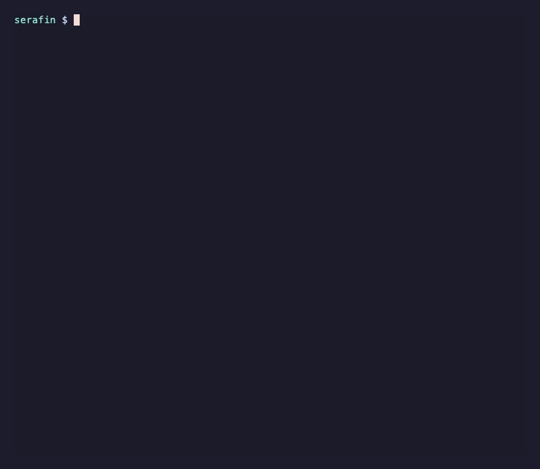
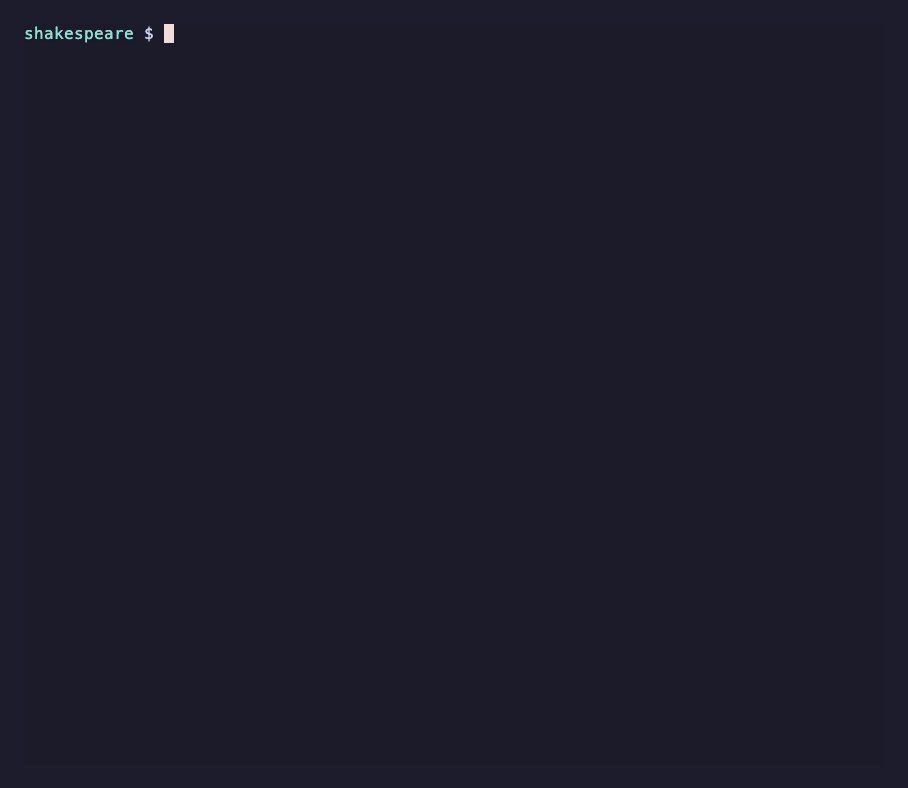
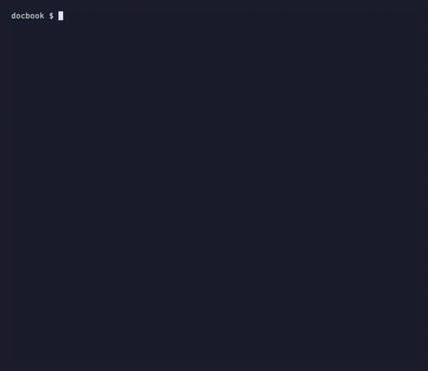
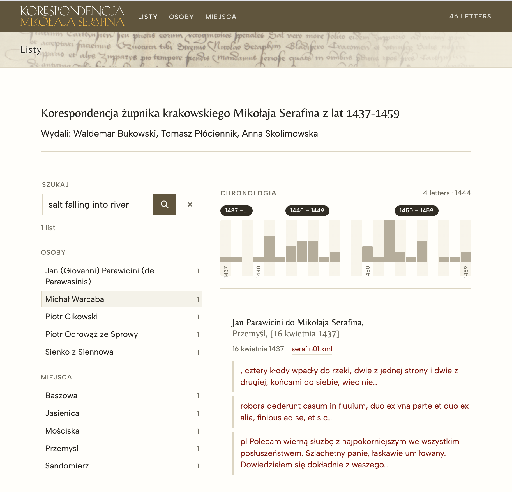

<style>
section {
  padding-top: 3rem !important;
}
header {
  /* background-color: #3a6a6a !important; */
  padding: 0.5rem 1rem;
  position: absolute;
  top: 0;
  left: 0;
  right: 0;
  width: 100%;
  margin: 0;
  box-sizing: border-box;
  z-index: 1;
}
header div {
  display: flex;
  justify-content: space-between;
  align-items: center;
  width: 100%;
}
.images {
    display: flex;
    justify-content: space-between;
    align-items: center;
    width: 100%;
    margin-top: 1rem;
}
section .fill-below {
    display: block;
    max-width: 100%;
    max-height: calc(100vh - 20rem);
    object-fit: contain;
    margin: 0.5rem auto 0;
}
.supporters {
    display: flex;
    flex-wrap: wrap;
    justify-content: center;
    align-items: center;
    gap: 1.5rem 2rem;
    margin: 1.5rem 0 1rem;
    padding: 0;
    list-style: none;
}
.supporters li {
    flex: 0 1 28%;
    max-width: 28%;
    margin: 0;
    display: flex;
    flex-direction: column;
    align-items: center;
    justify-content: center;
    gap: 0.4rem;
    text-align: center;
}
.supporters img {
    height: auto;
    width: auto;
    max-height: 3.2rem;
    max-width: 100%;
    object-fit: contain;
    margin: 0;
}
.supporters img[src*="ZB_Logo"] {
    max-height: 4.4rem;
}
.supporters .supporters__note {
    font-size: 0.55rem;
    line-height: 1.3;
    color: #555;
}
.supporters--initiative {
    margin-top: 0.5rem;
}
.supporters--initiative img {
    max-height: 2.8rem;
}
section.lead {
  display: flex;
  align-items: center;
  justify-content: space-between;
  gap: 2rem;
  text-align: left;
}
section.lead h1,
section.lead h2,
section.lead p,
section.lead ul {
  text-align: left;
}
section.lead .opening {
  display: flex;
  align-items: center;
  justify-content: space-between;
  gap: 3rem;
  width: 100%;
}
section.lead .opening__text {
  flex: 1 1 auto;
  min-width: 0;
}
section.lead .opening__logo {
  flex: 0 0 auto;
  width: 12rem;
  height: auto;
  margin: 0;
}
.split {
  display: flex;
  align-items: center;
  justify-content: space-between;
  gap: 2rem;
  width: 100%;
  height: 100%;
}
.split__text {
  flex: 1 1 42%;
  min-width: 0;
}
.split__media {
  flex: 0 1 55%;
  max-width: 55%;
  margin: 0;
  border-radius: 0.4rem;
  box-shadow: 0 0.4rem 1.2rem rgba(0, 0, 0, 0.12);
}
</style>

<div class="opening">
<div class="opening__text">

# Open Processing Model Release

## e-editiones community call 
September 15, 2026

Wolfgang Meier

</div>

</div>

---

<div class="split">
<div class="split__text">

# Open Processing Model

- an implementation of the TEI Processing Model in Python
- lightweight, blazingly fast, few dependencies

</div>

</div>

---

# Use for

- quick __preview__ of documents
- __batch transformation__ of large collections
- __pre-rendering__ content for TEI Publisher
- producing an entirely __static website__

---

# OPM vs tei-publisher-lib

- benefits from lessons learned, but a completely fresh implementation
- `opm` compiles ODD to Python where `tei-publisher-lib` compiles to XQuery
- same extensions to the spec as `tei-publisher-lib`
- ODDs can be shared between implementations!

---

# Code Comparison

`tei-publisher-lib`:

```xquery
case element(p) return
    html:paragraph($config, ., css:get-rendition(., ("tei-p", "tei-p3", css:map-rend-to-class(.))), .)
case element(list) return
    html:list($config, ., css:get-rendition(., ("tei-list", "tei-list1", css:map-rend-to-class(.))), child::node(), ())
```

`opm`:

```python
case 'p':
    return pmf.paragraph(config, node, ['tei-p', 'tei-p3', r], node)
case 'list':
    return pmf.list(config, node, ['tei-list', 'tei-list1', r], config.xpath.select(node, 'child::node()'))
```

---

# Differences

- `opm` is XPath 3.1 only! no XQuery
- no database: additional documents/collection need to be configured up front
- extension/helper functions must be in python

---

# Output Modes

- `web`: HTML pages
- `markdown` (extends `plain`): plain text markdown
- `epub` (extends `web`): ePub books
- `typst`: high quality print PDF (similar to LaTeX)
- `print` (extends `web`): HTML with CSS for print
- `docx`: Word document
- `json`: traces how the ODD transformed the input (logging and debugging)

---

<div class="split">
<div class="split__text">

# Commands: `init`

- scaffold a project
- empty project using TEI, docbook or JATS
- extend one of the examples

</div>

</div>

---

<div class="split">
<div class="split__text">

# Commands: `transform`

- transforms single input to single output
- best for quick previews, exports or print production

</div>

</div>

---

<div class="split">
<div class="split__text">

# Commands: `chunk`

- paginate large documents
- batch process entire collections
- one XML document may generate multiple output fragments
- `web` output mode only

</div>

</div>

---

# Chunk Formats

- `html`: output rendered through Jinja2 template
- `json`: ideal to export data to a static site generator
- `pb-view`: TEI Publisher's format for pre-rendered content views

---

<div class="split">
<div class="split__text">

# Command: `index`

- produce JSON ideal for import into external search engine 
- index the actual reading view
- chunk large sections with overlap (`min_chars`/`max_chars`)
- attach additional fields/facets

</div>

</div>

---

# License

- __AGPL__ version 3
- Members use __LGPL__ version 3!
- configurations, templates + generated code: __CC0__ 1.0 Universal
- e-editiones relies on membership
- give something back to the people and institutions supporting it

---

# Links

- Homepage: [https://opm.e-editiones.org](https://opm.e-editiones.org)
- Install: `pip install open-processing-model` or `uv tool install open-processing-model`
---

# Supporters

<ul class="supporters">
  <li>
    
  </li>
  <li>
    
  </li>
  <li>
    
  </li>
  <li>
    
    <span class="supporters__note">Zentrum Digitale Editionen &amp; Editionsanalytik</span>
  </li>
  <li>
    
    <span class="supporters__note">Karl Barth-Stiftung</span>
  </li>
</ul>
